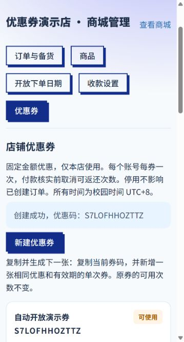

# 优惠券免部署平台配置设计与验证

日期：2026-10-24。状态：本地实现与验证完成，未提交、未推送、未创建 PR，未部署线上。
来源：用户要求在生产库已完成 077 迁移的前提下，使优惠券不依赖登录 Railway 手工启用配置。

## 范围与决策

将原先必须 SHOP_COUPONS_ENABLED=1 才能使用的策略改为：未配置、空值或 auto 时，数据库满足完整优惠券结构就自动可用；1 同样要求结构完整；0 明确关闭；未知值按关闭处理并在只读运维检查报告配置错误。保留主动停用能力，不覆盖服务器显式的 0。

线上仍须正常部署更新后的代码。这项修改免去登录托管平台新增开启变量，并不使本地文件直接影响线上。现有线上环境是否显式配置了 0 无法从公开接口获知；如存在，仍需有部署权限的维护者解除显式关闭。

## 联动与一致性

后端运行时与只读发布核查共用一份结构合同，检查 077 涉及的全部列及券码唯一、创建幂等唯一、订单使用记录唯一约束。只读元数据，不执行 DDL，不自动创建或修改数据库；结构缺失、数据库不可达均返回不可用。

学生 catalog 的 coupons_enabled、商家发券、管理员发券、试算与下单继续使用同一 ready 门禁。不新增账号或权限；单店隔离、价格库存服务端复核、券次数事务和取消/核销规则保持。已创建优惠订单的重试和状态处理不依赖开关重新放行；无券下单保持兼容。

前端取消要求用户登录平台启用配置的固定提示，不可用时提供重新检查。没有把不可用状态伪装成成功。

## 实施与验证计划

1. 提取共享只读结构检查，覆盖缺列、缺唯一约束与数据库错误。
2. 实现默认自动模式与显式关闭兼容，用独立本地真实数据库验证无环境变量的发券、试算、下单、核销和送达。
3. 启动不带开启变量的本地 Web/API，实际发券和用券核对金额，再运行完整测试、lint 和构建。

无需新增数据库迁移；不读取或修改生产环境变量、不连接生产库、不推送或发起 PR。待本地验收后由用户决定发布。

## 浏览器验证记录

已将独立本地 API 的 SHOP_COUPONS_ENABLED 完全移除，而不是改为 1。浏览器真实完成：商家创建单次满15减5券；学生选20元商品、试算为15元、提交订单、上传生成的演示截图；商家接单核销、备货、配送、完成。没有真实付款、生产订单或消息发送。

相关用例已覆盖完整事务链路和重复操作；运行环境只使用固定本机3308与专用演示/测试库。

## 最终验证结果

完整 Jest：73 套件、1076 用例通过，无跳过；包含独立本地数据库的并发、幂等、取消返还、核销及自动模式完整配送链路。Web lint、生产构建退出码均为 0，保留已有 Shop.jsx 动静态导入提示。只读发布核查在完全没有优惠券开关的本地配置下输出 couponMode=auto、schema.ready=true、ready=true。

