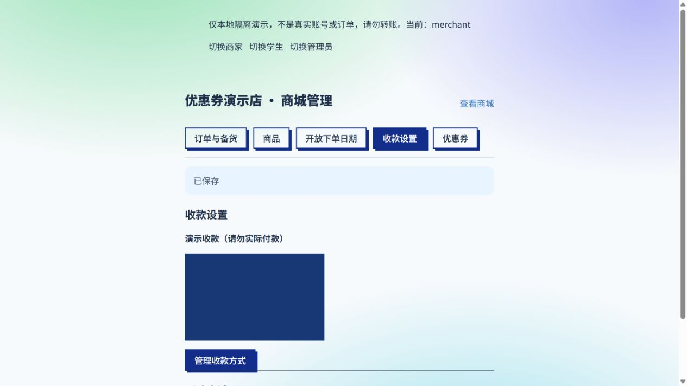
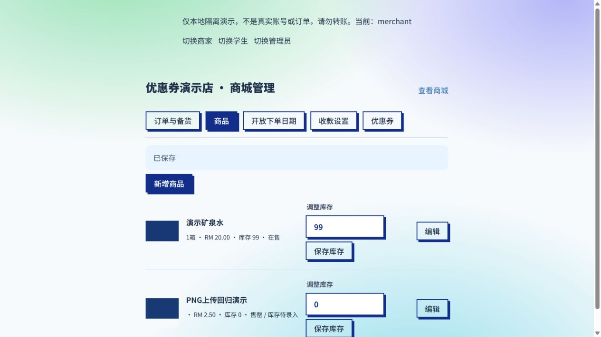

# 商家收款设置与 PNG 上传修复

日期：2026-10-24。基线：main 2de73a08。范围仅 Web 与商城后端，无数据库结构变更。

## 问题与方案

已复现：非营业时段，公共 catalog 按学生规则隐藏 payment_methods；商家后台误用该数据，错误显示未添加，并用空列表初始化编辑器。新增受现有成员权限保护的 GET /admin/settings，商家只读自己店铺的真实配置；后台查询与公共目录缓存分开，保存后统一失效。学生端时段限制保持。

PNG 上传目前过度依赖浏览器 MIME，与文件真实内容可能不一致。前端按扩展名或已知类型允许选择，后端以 Sharp 实际解码格式为准，只接受 JPEG/PNG/WebP 并重编码，不接受 SVG 或伪造文件；保持 5MB 与 1600 万像素限制，分别说明尺寸和存储失败。尚不能断定用户原文件具体触发哪条规则，需以原图或线上部署后复测确认。

## 验证与上线

计划：接口回归覆盖未登录、学生、他店商家、管理员和非营业设置；图片回归覆盖 PNG MIME 缺失/别名、伪造文件、容量和存储故障。修改前已在独立本地演示库复现后台误报。修改后继续本地 UI 上传、保存、重新编辑及学生闭店检查，运行测试、lint 与 build。

无需新增迁移。线上生效需要审核并部署修复代码，不能只改本地数据库或环境文件。未修改 App 或生产业务数据。

## 已完成验证

- 修改前在非营业时段复现：原收款方式已保存在库内，但管理页显示未添加。
- 修改后实际浏览器验证：关闭所有下单时段，后台能显示原收款码并保留编辑名称；上传 PNG、保存收款设置成功，图片 naturalWidth=320；新增 PNG 商品成功，重新打开编辑器仍保留图片、名称和价格。
- 学生端仍提示不在开放时段，未显示收款码。仅修改独立演示库，未创建生产订单或上传生产图片。
- 最终整合 main b15ef47b 后，完整 Jest：73 套件、1023 项通过，无跳过；最终针对性回归 128 项通过；Web lint、生产 build 退出码均为 0，保留原 Shop.jsx 动静态导入提示。
- 不声称已重现用户原 PNG 的具体编码问题：原图未提供；如原文件超过 5MB 或 1600 万像素，会提示缩小图片，损坏/非支持内容仍拒绝。
- 复用现有 ShopSettingsFields、ShopProductImage、ShopImage、Modal、TanStack Query、shared/api/shop、Sharp、对象存储和店铺权限。共享 API 仅增加方法，不改变现有客户端契约，无 App 文件改动。

## 本地验证截图

下图均为明确标注的本地演示数据，蓝色矩形为生成的测试图片，并非真实收款码。

学生端商品详情与大图预览也已实际打开验证。修复代码待 PR 审核部署，本记录不代表线上已经生效。
